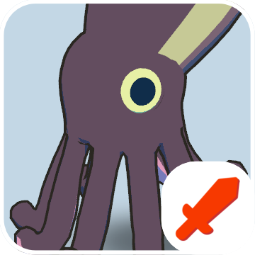
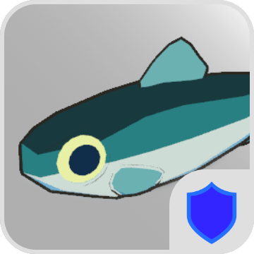
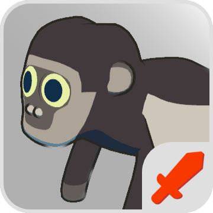
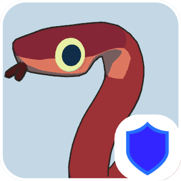

# Animal Strategy Game
## Manual
### About
自陣守備対象ユニットを守りつつ、敵陣の目標ユニットを倒す
タイムライン制攻撃システムを用いた戦略ゲームです。
よくある兵器ではなく、動物達によって繰り広げられる世界観が特徴です。

### Rule
プレイヤーは自然回復される、ユニットを呼ぶために必要な「アニマルポイント」と、敵陣への攻撃に用いる「エネルギー」があります。 

上記2つを上手く駆使してターン毎の制限時間内に各種ユニットを呼出し、自陣のHQユニットを守りながら敵陣のHQユニットを破壊しましょう。 
敵陣のHQユニットを全て破壊したら勝利となります。

### Mode
画面左上に各ターンにおける行動モードが表記されています。それぞれ以下の操作が出来ます。
| Name | Description |
| --- | --- |
| INIT | ゲーム開始直後に一回のみ行われます。HQを指定数配置しなければいけません。 |
| PREPARATION | 自陣にユニットを呼出または撤退させることができます。 また呼出した攻撃ユニットを選択してCOMMANDフェーズへ移行が出来ます。 COMMANDモードと準備制限時間を共有します。 |
| COMMAND | 敵陣上で攻撃目標地点を選択して、攻撃コマンドの予約が出来ます。 コマンドは動物の速度値+制限時間の経過秒数で行動順が決まります。 一度予約されたコマンド取り消しは出来ません。 PREPARATIONモードと準備制限時間を共有します。 |
| ACTION | タイムラインに登録された攻撃コマンドを順次実行されます。 操作できることがないため、動物達の戦いを見守りましょう。 |
| GAME OVER | どちらかのHQが全破壊された時に移行します。ゲームのリセットが出来ます。 |

### Unit
| Icon | Name | Description |
| --- | --- | --- |
|  | **HeadQuarter (本部)**       | 攻撃及び防衛目標。HPは高いが存在するだけで何も出来ない。 |
|  | **Squid (イカ)**       | イカの **「墨」** を目標に向けて飛ばし遠距離から一方的な攻撃をします。墨は範囲内の全てのユニットへダメージを与えます。|
|  | **Herring (ニシン)**    | ニシンは **「巨大な群れを形成」** し集団で遠距離攻撃を確率で守ってくれます。|
|  | **Colobus (コロブス)**   | 輸送ドローンで直接陣地に侵入し、目標地点を中心とした広範囲の行動エリアの中で一番近い敵ユニットを順次攻撃します。
|  | **Taipan (タイパン)**    | 自陣に侵入した敵ユニットを迎撃します。侵入した敵ユニットへの反撃手段を持たないユニットの防衛に向いています。 |

## Portfolio
### Why I Made This Game
Unityを用いたゲーム開発の勉強として作成。（初作品） 
ストラテジーゲームは他ジャンルと比べて実装が大変な印象があり、複雑なロジック及びオブジェクト指向をはじめとした設計手法に慣れるために最適と考え、このゲームジャンルを採用。 

### Key Implementation Points
開発初期の段階から、取り入れるべき設計手法やGC負荷となる処理に気を付けながら実装を行った。
- 継承可能なユニットクラス定義
    - 基底クラス -> 役割別（Attacker等）ジェネリクスクラス -> 動物別（Colobus等）クラス
    - 上記をユニットの「Body」「Stats」「Controller」「Animation」で定義出来るように準備。
- GC対策
    - List及びArrayの長さ指定
    - ユニットデータ管理としてScriptableObjectを適用
    - タイル、ユニット、パーティクルの各オブジェクトをObjectPoolで生成。
- シーン初期読み込み時における複数のマネージャークラス処理について
    - 肥大化したシングルトンパターンクラスの初期化処理における依存関係のすれ違い防止を行うため、BootStrapperクラスで順番にSetup処理出来る形にした。
        - 後にDIというものを知ったため、よく出てくるVContainer等を利用して大きく改善を図れそうであれば導入してみたい。

### Core Packages
| Package | version |
| --- | --- |
| UniTask | 2.5.10 |
| Unity Toon Shader | 0.12.0-preview |

